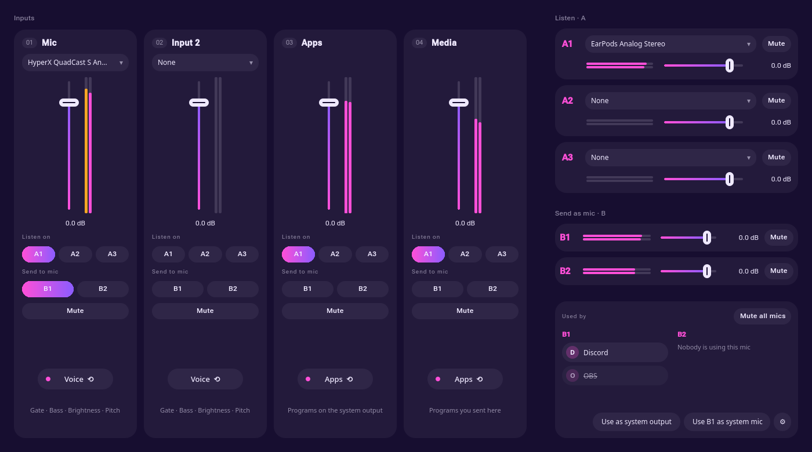
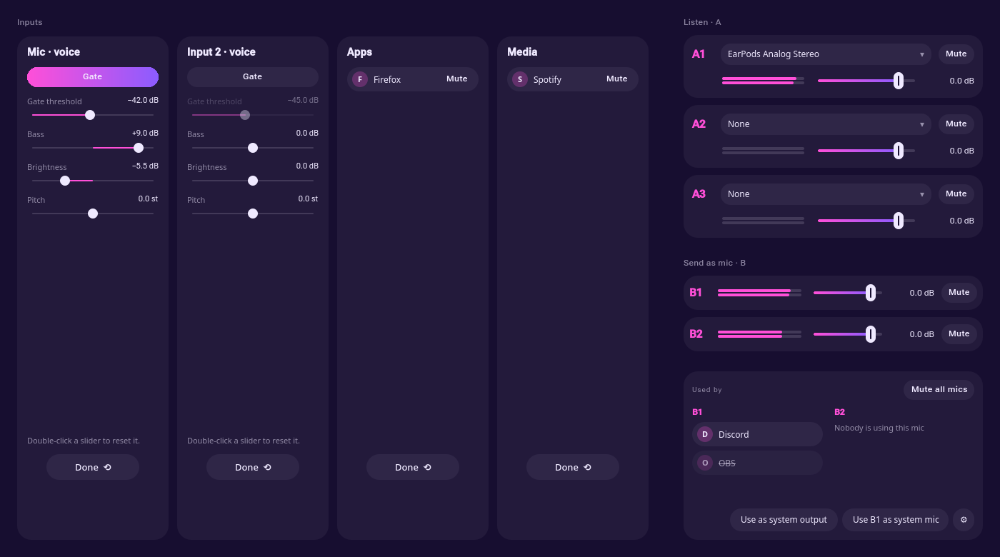
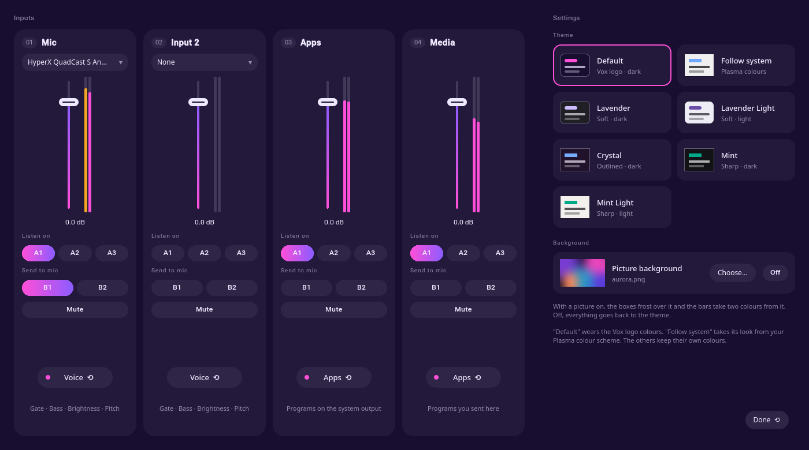
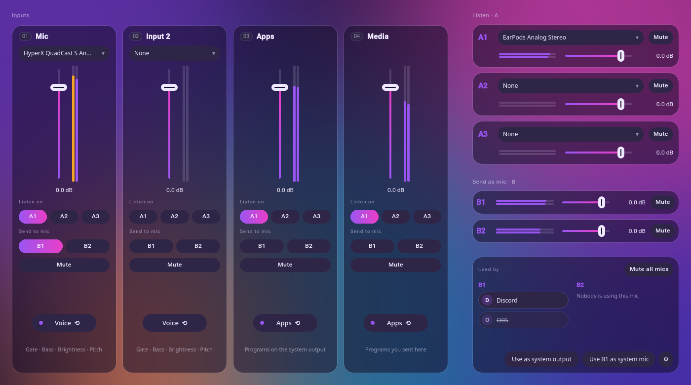
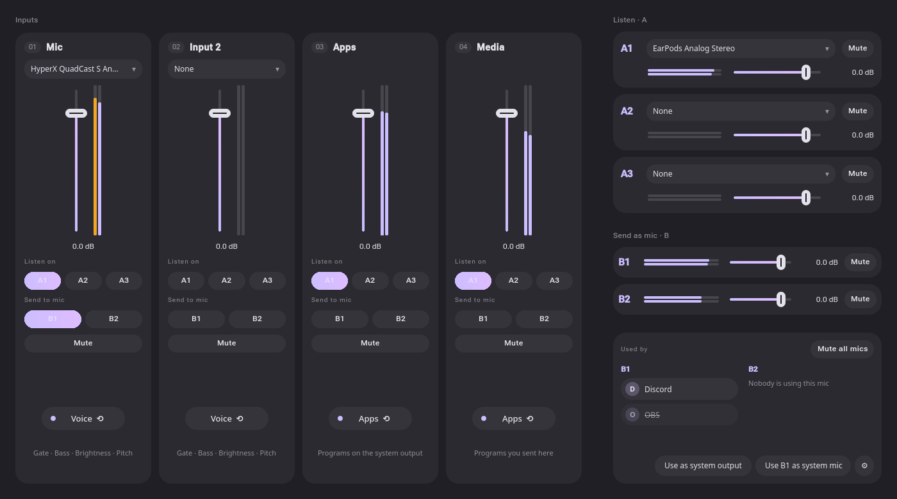
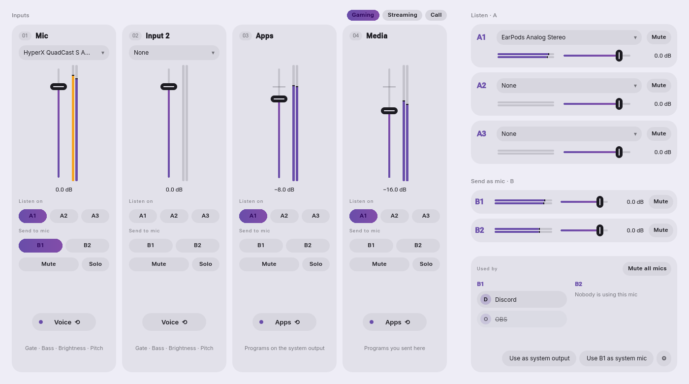
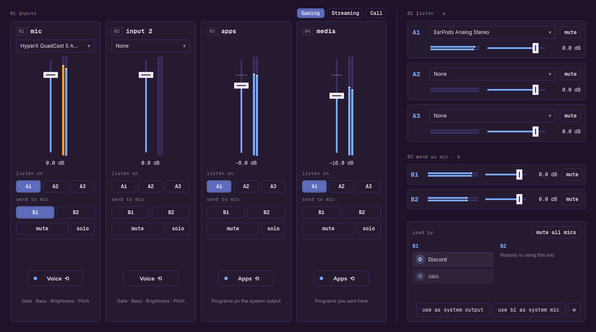
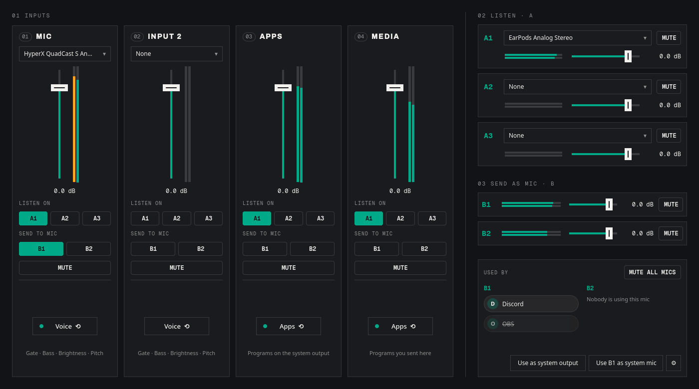
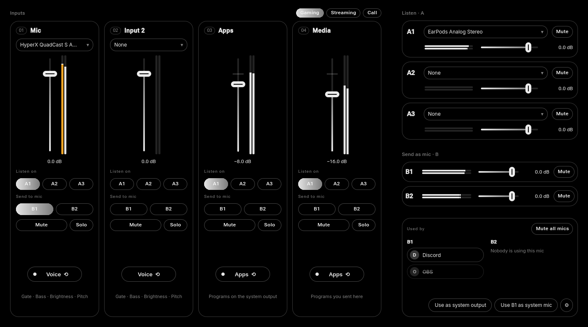

# Vox Obscurus

A small audio mixer and router for Linux (PipeWire), in the spirit of Voicemeeter Banana but
cut down to the parts that matter for everyday voice and streaming. Rust + PipeWire for the
audio, Qt Quick for the interface. Not affiliated with VB-Audio.

Every strip flips over: mic strips to their voice tools, Apps and Media to the programs using them.
The gear at the bottom right flips the other side over to the settings and themes.

| Voice tools (back of a mic strip) | Settings, themes and background |
| --- | --- |
|  |  |

Pick any picture as the window background (Settings → Background): the boxes frost over it and the
bars take their colours from it.

| Lavender (soft, dark) | Lavender Light (soft, light) |
| --- | --- |
|  |  |

| Crystal (outlined, dark) | Mint (sharp, dark) |
| --- | --- |
|  |  |

**Pure Black** is for OLED screens: a true black window, every box drawn as a thin outline, and a grey
gradient instead of colour. **Follow system** keeps the default look but takes its colours from your
Plasma colour scheme and follows accent changes live.

(Screenshots use made-up programs and levels.)

## How it works

- **Inputs (strips):** two hardware inputs (a mic, a line-in, anything PipeWire lists) and an
  **Apps** strip and a **Media** strip. Apps is a virtual output device called *Vox Obscurus
  Apps*: make it the system output (button at the bottom right) and every program plays through the
  mixer. Media is a second one, *Vox Obscurus Media*: in the volume applet's Applications tab,
  set a program's output to it to give that program its own strip (music, say). Voice tools
  (gate, bass, brightness, pitch) live on the mic strips.
- **A outputs (A1–A3):** what you listen on. Pick a device for each, like headphones or speakers.
- **B outputs (B1, B2):** virtual microphones, listed as *Vox Obscurus B1 (Mic)* and *B2 (Mic)*.
  Pick one as the microphone in Discord, OBS, or any other program.
- On each strip, light up **A** buttons to hear it and **B** buttons to send it into a mic.
- Mic strips have a **noise gate** (the threshold slider sets the level it opens at), **bass**,
  **brightness** and **pitch**. With pitch on, **Hear my natural voice** lets your A outputs play
  you without the pitch delay while the B mics still carry the pitched voice.
- **Duck Apps & Media** (back of a mic strip): while you talk, Apps and Media dip by an amount you
  set, on the B mics and optionally on A, and come back a moment after you stop.
- Each strip has **Solo**: while any strip is soloed, A1–A3 play only the soloed strips. The B mics
  are never affected, and solo isn't saved.
- Meters show a **peak-hold** tick and a **clip light** that stays lit until you click the meter.
- The Apps strip warns you if voice chat is playing through it and also going to a mic.

### Programs

Flip Apps or Media to see the programs using it, each with its own mute. **Drag a program onto the
Apps or Media strip** to send it there. Programs playing straight to hardware show under
"Playing elsewhere" so you can pull them in.

### Scenes

Settings → Scenes saves every strip and bus as they are (devices, routes, levels, voice tools)
under a name. The first five show as buttons above the inputs, and all of them are in the tray
menu. Loading one leaves your theme and background alone.

### Tray and shortcuts

- **Tray icon:** show or hide the window, mute the mics, switch scenes, quit. Turn on *Keep running
  in the tray* (Settings → Behaviour) and closing the window leaves the mixer running.
- **Push to talk:** while it's on, your mic strips only reach B1 and B2 while its key is held. You
  still hear yourself on A, and Apps and Media are never gated.
- **Mute microphones:** one key mutes or unmutes B1 and B2.
- Both keys are yours to choose (Settings → Shortcuts: click the box and press the keys you want).
  They are global shortcuts handled by KDE's shortcut service, so they work while another program
  has focus, also show up in System Settings → Shortcuts, and need KDE Plasma.

Feedback loops can't be wired from the UI: the virtual devices never appear as inputs or
A outputs, and all of the mixer's own streams share a PipeWire link group.

## Support development

Vox Obscurus is free. If it's useful to you and you'd like to help fund more work on it:

- Ko-fi: https://ko-fi.com/obscuratea
- Patreon: https://patreon.com/Obscuratea
- Discord: https://discord.gg/uqV26sCQFq

## Bugs and suggestions

Found a bug or have an idea? Please open an issue on the Issues page. It really helps. I'm
not taking code contributions, but every report and suggestion is read.

## License

Free to download and use, including commercially (a streamer or VTuber using it for audio
routing is exactly what it's for). Not open source: you can't modify it, redistribute it, publish
forks or derived versions, or sell it. See [LICENSE](LICENSE).

## Build and run

Needs Rust, Qt 6 (base, declarative, and Widgets for the tray icon), PipeWire development files,
SoundTouch and clang.

    cargo run --release

Settings are saved to `~/.config/vox-obscurus/settings.json` (with a `.bak` of the last good copy,
so a damaged file never wipes your layout).

If a device (a USB headset, say) isn't there when Vox starts, or is unplugged and plugged back in,
Vox opens its stream again by itself when the device returns.

## Developing

- Qt sends its log to the systemd journal when it isn't attached to a terminal. Run with
  `QT_FORCE_STDERR_LOGGING=1` to see QML errors in the terminal.
- `vox-obscurus --screenshot out.png` saves an image of the window after two seconds and quits.

## Layout

- `src/engine.rs`: PipeWire streams, virtual devices, mixing and routing (runs on its own thread)
- `src/dsp.rs`: noise gate, shelf filters and the pitch stage (SoundTouch)
- `src/settings.rs`: the saved layout and scenes
- `src/shortcuts.rs`: global shortcuts through KDE's KGlobalAccel (D-Bus)
- `src/bridge.rs`: the `Mixer` object QML talks to (JSON in, JSON out)
- `src/qt_shim.cpp`: creates the `QApplication` the tray icon needs
- `qml/`: the interface
