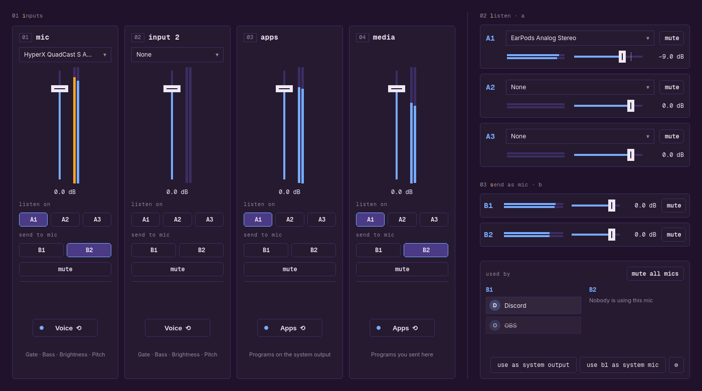
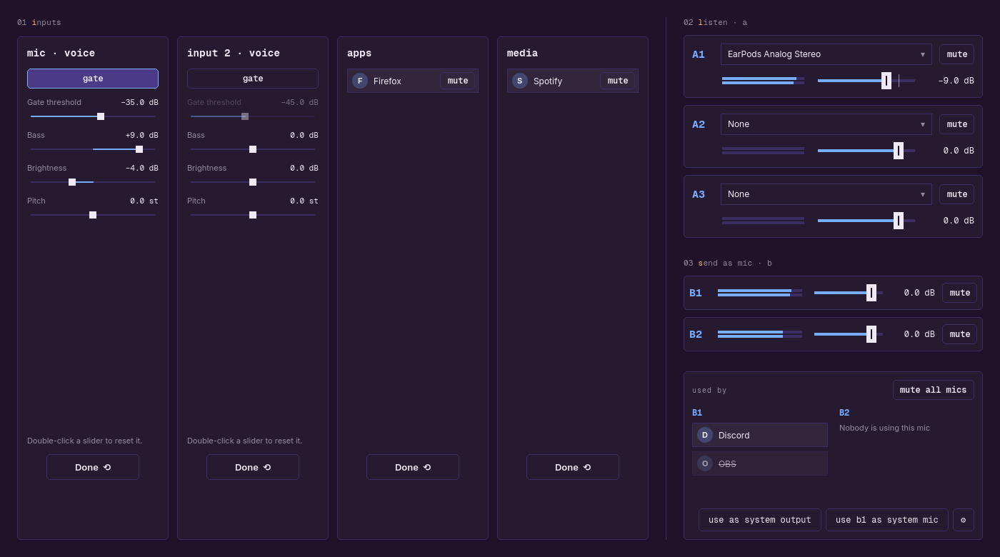
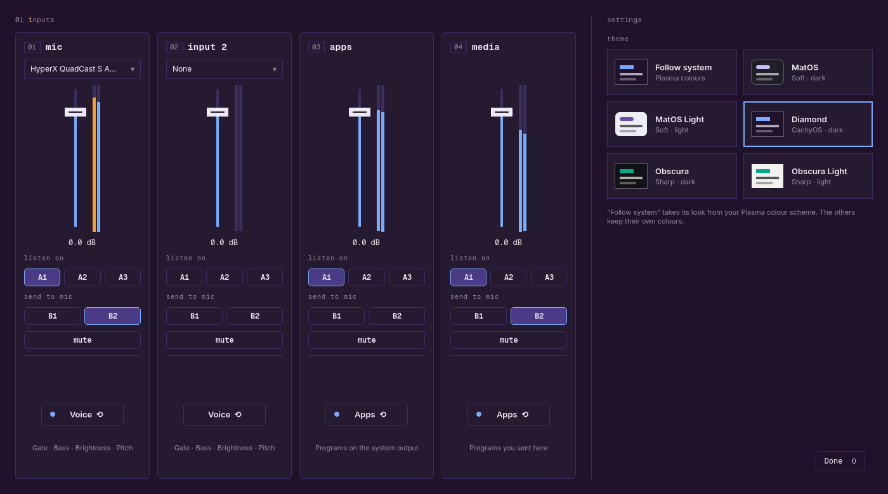
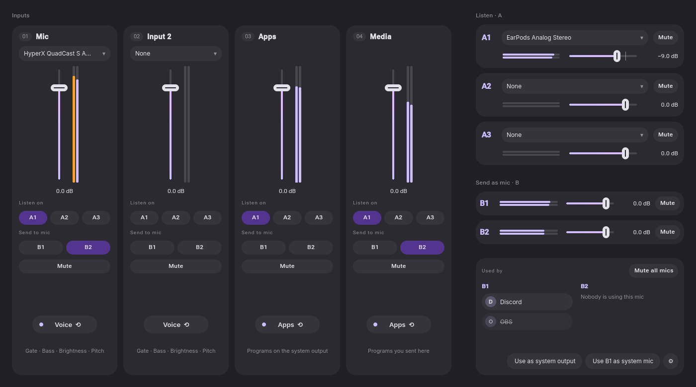
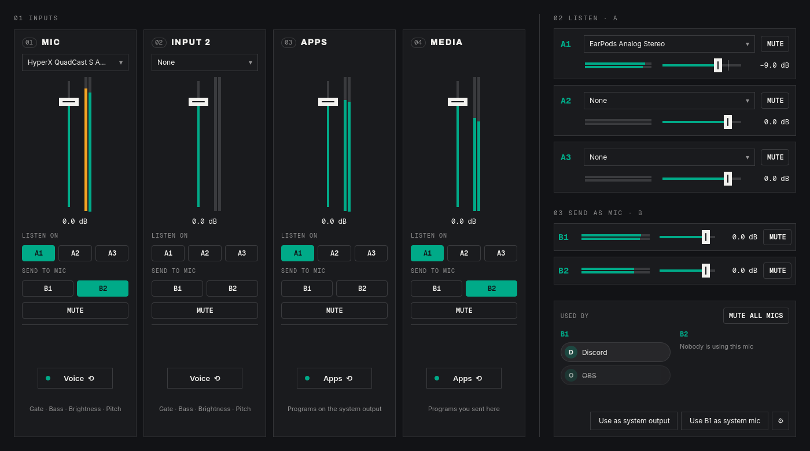

# Vox Obscurus

A small audio mixer and router for Linux (PipeWire), in the spirit of Voicemeeter Banana but
cut down to the parts that matter for everyday voice and streaming. Rust + PipeWire for the
audio, Qt Quick for the interface. Not affiliated with VB-Audio.

Every strip flips over: mic strips to their voice tools, Apps and Media to the programs using them.
The gear at the bottom right flips the other side over to the settings and themes.

| Voice tools (back of a mic strip) | Settings and themes |
| --- | --- |
|  |  |

| MatOS | Obscura |
| --- | --- |
|  |  |

(Screenshots use made-up programs and levels.)

## How it works

- **Inputs (strips):** two hardware inputs (a mic, a line-in, anything PipeWire lists) and an
  **Apps** strip and a **Media** strip. Apps is a virtual output device called *Vox Obscurus
  Apps*: make it the system output (button at the bottom right) and every program plays through the
  mixer. Media is a second one, *Vox Obscurus Media*: in the volume applet's Applications tab,
  set a program's output to it to give that program its own strip (music, say). Voice tools
  (gate, bass, brightness, pitch) live on the mic strips.
- **A outputs (A1–A3):** what you listen on. Pick a device for each, like headphones or speakers.
- **B outputs (B1, B2):** virtual microphones, listed as *Vox Obscurus B1 (Mic)* and *B2 (Mic)*.
  Pick one as the microphone in Discord, OBS, or any other program.
- On each strip, light up **A** buttons to hear it and **B** buttons to send it into a mic.
- Mic strips have a **noise gate** (the threshold slider sets the level it opens at), **bass**,
  **brightness** and **pitch**.
- The Apps strip warns you if voice chat is playing through it and also going to a mic.

Feedback loops can't be wired from the UI: the virtual devices never appear as inputs or
A outputs, and all of the mixer's own streams share a PipeWire link group.

## Support development

Vox Obscurus is free. If it's useful to you and you'd like to help fund more work on it:

- Ko-fi: https://ko-fi.com/obscuratea
- Patreon: https://patreon.com/Obscuratea

## Bugs and suggestions

Found a bug or have an idea? Please open an issue on the Issues page. It really helps. I'm
not taking code contributions, but every report and suggestion is read.

## License

Free to download and use, including commercially (a streamer or VTuber using it for audio
routing is exactly what it's for). Not open source: you can't modify it, redistribute it, publish
forks or derived versions, or sell it. See [LICENSE](LICENSE).

## Build and run

Needs Rust, Qt 6 (base, declarative), PipeWire development files and clang.

    cargo run --release

Settings are saved to `~/.config/vox-obscurus/settings.json`.

## Developing

- Qt sends its log to the systemd journal when it isn't attached to a terminal. Run with
  `QT_FORCE_STDERR_LOGGING=1` to see QML errors in the terminal.
- `vox-obscurus --screenshot out.png` saves an image of the window after two seconds and quits.

## Layout

- `src/engine.rs`: PipeWire streams, virtual devices, mixing and routing (runs on its own thread)
- `src/dsp.rs`: noise gate and shelf filters
- `src/settings.rs`: the saved layout
- `src/bridge.rs`: the `Mixer` object QML talks to (JSON in, JSON out)
- `qml/`: the interface
