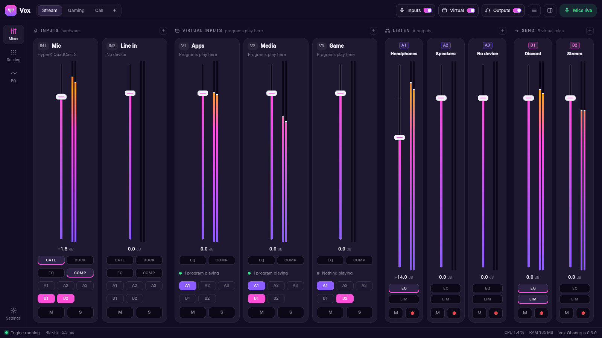
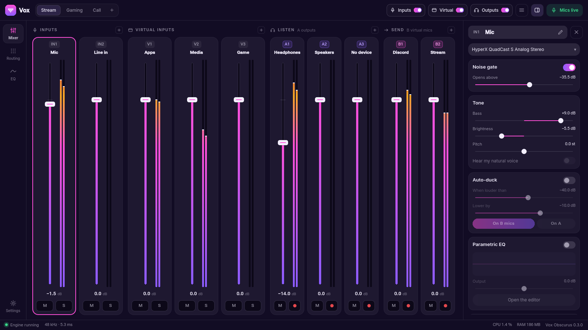
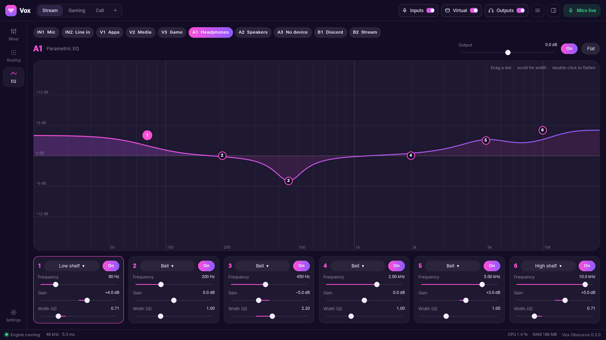

# Vox Obscurus

A small audio mixer and router for Linux (PipeWire), in the spirit of Voicemeeter Banana but
cut down to the parts that matter for everyday voice and streaming. Rust + PipeWire for the
audio, Qt Quick for the interface. Not affiliated with VB-Audio.

Want more channels and plugins? See [Vox Pro](https://github.com/Obscuratea/vox-pro).

Click a strip to open its inspector on the right: its device, voice tools, EQ, compressor or limiter,
and where it goes.

| An input | An output, recording |
| --- | --- |
|  |  |

| Parametric EQ | Routing |
| --- | --- |
|  |  |

Four themes: **Night** (above), **Glass** (see-through, blurred by KWin), **Light** and **Gold**, or any
picture as the window background.

| Gold | Light |
| --- | --- |
|  |  |

(Screenshots use made-up programs and levels.)

## How it works

- **Inputs:** hardware inputs (a mic, a line-in, anything PipeWire lists) and **virtual inputs** that
  programs play into. Each virtual input is a device called *Vox Obscurus Apps*, *Vox Obscurus Media* and
  so on: make one the system output and every program plays through the mixer, or send single programs to
  their own strip.
- **A outputs:** what you listen on. Pick a device for each, like headphones or speakers.
- **B outputs:** virtual microphones, listed as *Vox Obscurus B1 (Mic)* and so on. Pick one as the
  microphone in Discord, OBS or any other program.
- **Add or remove channels** with the **+** in each section header or in Settings → Layout (up to 5
  hardware inputs, 6 virtual inputs, 5 A outputs and 3 B outputs). Name any channel; its A1 / B1 tag stays.
- On each input, light up **A** buttons to hear it and **B** buttons to send it into a mic, or use the
  **Routing** page for every input and output at once.
- **Voice tools** on hardware inputs: noise gate, bass, brightness and pitch. With pitch on, **Hear my
  natural voice** lets the A outputs play you without the pitch delay while the B mics still carry it.
- **Auto-duck:** while you talk, the virtual inputs dip by an amount you set, on the B mics and
  optionally on A.
- **Parametric EQ** on every input and output: six cells, each a bell, shelf, pass filter or notch.
  Drag the dots on the curve or set exact values.
- **Compressor** on every input, **limiter** on every output.
- **Recording:** the red dot on an output records exactly what it carries, as FLAC, WAV or Opus, to
  `~/Music/Vox Obscurus` or a folder you pick.
- **Solo** on each input: while any input is soloed, the A outputs play only the soloed ones. The B mics
  are never affected.
- Meters show a **peak-hold** tick and a **clip light** that stays lit until you click the meter.
- **Show or hide** hardware inputs, virtual inputs and outputs from the top bar. A narrow window slims the
  strips down; a very small one lists the channels as rows.

### Programs

Open a virtual input's inspector to see the programs using it, each with its own mute. **Drag a program
onto a virtual input** to send it there. Programs playing straight to hardware show under
"Playing elsewhere" so you can pull them in.

### Scenes

A scene saves every channel as it is (devices, routes, levels, voice tools). Scenes sit in the top bar
(**+** to save one), in Settings → Scenes and in the tray menu. Loading one leaves your theme alone.
**Restore the last scene** (Settings → Behaviour) loads the last one at start.

### Tray, shortcuts and start-up

- **Tray icon:** show or hide the window, mute the mics, switch scenes, quit. With *Keep running in the
  tray* on, closing the window leaves the mixer running. The icon turns into a red dot while something
  records.
- **Global shortcuts** (Settings → Shortcuts): **push to talk** (the mic inputs only reach the B mics while
  the key is held), **mute all mics**, **next scene** and **show or hide Vox**. They go through KDE's
  shortcut service, so they work while a game has focus and need KDE Plasma.
- **Start with the computer** and **Start hidden** (Settings → Behaviour).
- **Mute mics when the screen locks**; they come back when you unlock.
- **Sample rate** (44.1, 48 or 96 kHz) and **latency** (Settings → Audio) are asked of PipeWire, never
  forced on other programs, and used from the next start.

Feedback loops can't be wired from the UI: the virtual devices never appear as inputs or
A outputs, and all of the mixer's own streams share a PipeWire link group.

## Install

Releases ship an Arch package. Download `vox-obscurus-*-x86_64.pkg.tar.zst` from the
[Releases page](https://github.com/Obscuratea/vox-obscurus/releases) and install it:

    sudo pacman -U vox-obscurus-*-x86_64.pkg.tar.zst

After that, updates come from inside the app (Settings → About).

## Support development

Vox Obscurus is free. If it's useful to you and you'd like to help fund more work on it:

- Ko-fi: https://ko-fi.com/obscuratea
- Patreon: https://patreon.com/Obscuratea
- Discord: https://discord.gg/uqV26sCQFq

## Bugs and suggestions

Found a bug or have an idea? Please open an issue on the Issues page. It really helps. I'm
not taking code contributions, but every report and suggestion is read.

## License

Free to download and use, including commercially (a streamer or VTuber using it for audio
routing is exactly what it's for). Not open source: you can't modify it, redistribute it, publish
forks or derived versions, or sell it. See [LICENSE](LICENSE). Credits and third-party licences (Qt and
SoundTouch are LGPL, used as system libraries) are in Settings → About and in
[THIRD_PARTY.txt](THIRD_PARTY.txt).

## Build and run

Needs Rust, clang, cmake, Qt 6 (base, declarative, and Widgets for the tray icon), KWindowSystem,
PipeWire development files and SoundTouch.

    cargo run --release

Settings are saved to `~/.config/vox-obscurus/settings.json` (with a `.bak` of the last good copy,
so a damaged file never wipes your layout).

If a device (a USB headset, say) isn't there when Vox starts, or is unplugged and plugged back in,
Vox opens its stream again by itself when the device returns.

## Developing

- Qt sends its log to the systemd journal when it isn't attached to a terminal. Run with
  `QT_FORCE_STDERR_LOGGING=1` to see QML errors in the terminal.
- `vox-obscurus --screenshot out.png` saves an image of the window after two seconds and quits.
- Every QML file except `qml/Main.qml`, and the shared Rust files (`dsp.rs`, `peq.rs`, `recorder.rs`,
  `shortcuts.rs`, `desktop.rs`), are the same in Vox Pro.

## Layout

- `src/engine.rs`: PipeWire streams, virtual devices, mixing, routing and limiters (runs on its own thread)
- `src/dsp.rs`: noise gate, shelf filters, compressor and the pitch stage (SoundTouch)
- `src/peq.rs`: the parametric EQ
- `src/recorder.rs`: WAV, FLAC and Opus writers
- `src/settings.rs`: the saved layout, scenes and preferences
- `src/shortcuts.rs`: global shortcuts through KDE's KGlobalAccel (D-Bus)
- `src/desktop.rs`: start with the computer, and the screen-lock watch
- `src/updater.rs`: the in-app updater
- `src/bridge.rs`: the `Mixer` object QML talks to (JSON in, JSON out)
- `src/qt_shim.cpp`: creates the `QApplication` the tray icon needs, and the glass blur
- `qml/`: the interface
