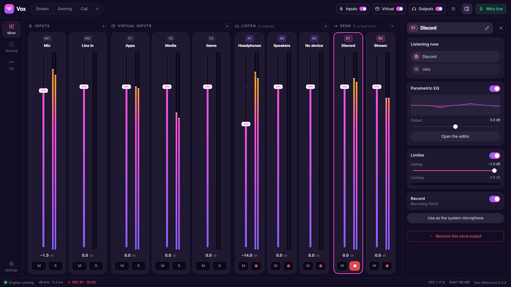
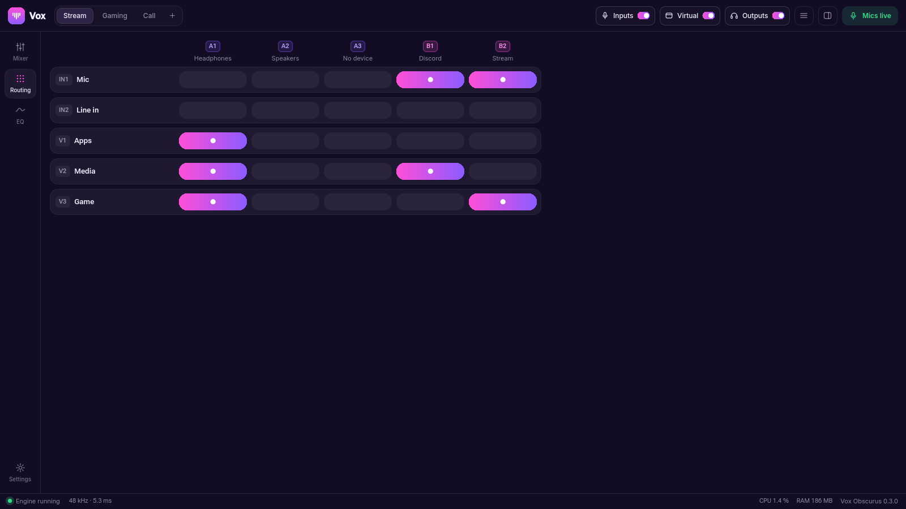
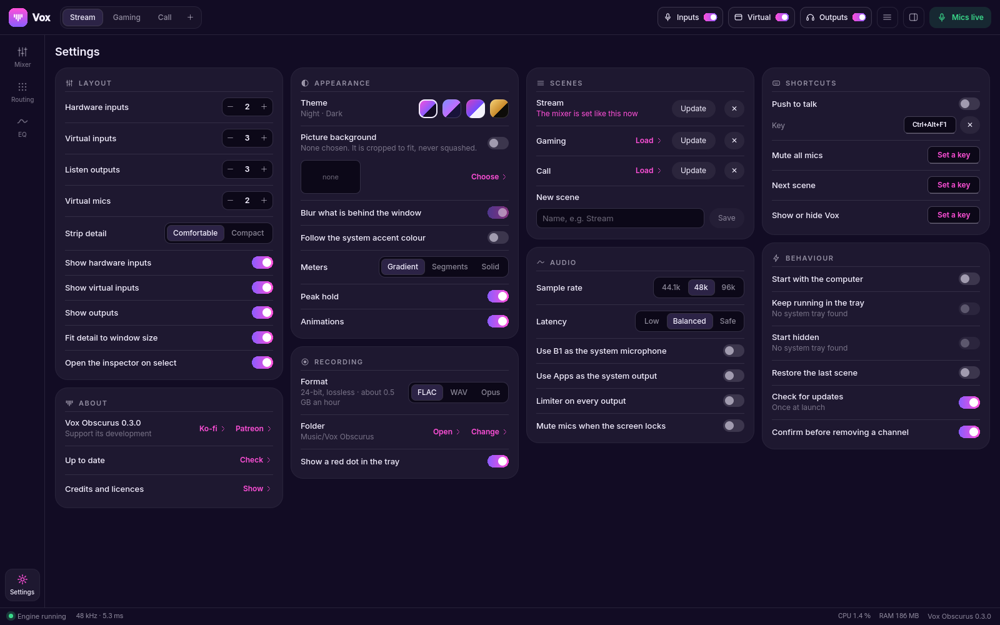
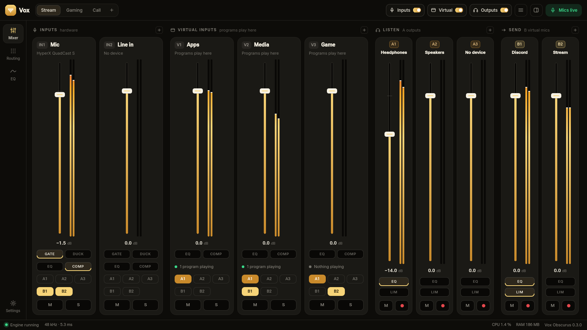
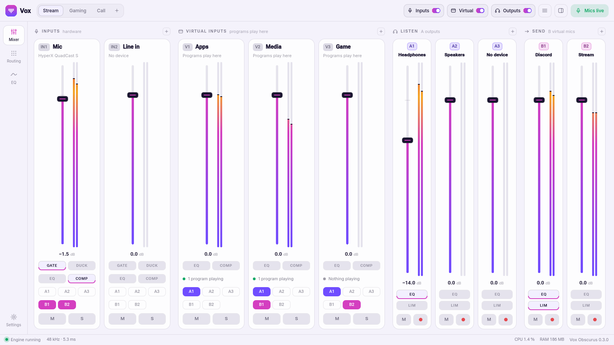

# Vox

Audio mixer and router for Linux (PipeWire). Rust + Qt Quick. Not affiliated with VB-Audio.
Previously named Vox Obscurus; the repository and the package keep the old name, `vox-obscurus`.

Made by [Obscuratea](https://github.com/Obscuratea), who designs Vox, decides what it does and how it
looks, tests every release and publishes it. The code is written with Claude Code (an AI coding tool);
[TESTING.md](TESTING.md) says how it is tested.

More channels and plugins: [Vox Pro](https://github.com/Obscuratea/vox-pro).

| Input inspector | Output inspector, recording |
| --- | --- |
|  |  |

| Parametric EQ | Routing |
| --- | --- |
|  |  |

| Gold | Light |
| --- | --- |
|  |  |

## Features

- **Hardware inputs** (up to 5) and **virtual inputs** (up to 6): devices named *Vox Apps*,
  *Vox Media* and so on that programs play into.
- **A outputs** (up to 5): your headphones or speakers.
- **B outputs** (up to 3): virtual mics, *Vox B1 (Mic)* and so on, for Discord, OBS and other programs.
- Routing per input to any A or B output, or from the Routing page.
- Noise gate, bass, brightness, pitch and auto-duck on hardware inputs.
- Parametric EQ (6 cells) on every channel, compressor on every input, limiter on every output.
- Mono and Dim (−20 dB) on A outputs.
- Recording any output to FLAC, WAV or Opus.
- Solo, per-program mute, drag a program onto a virtual input.
- Scenes, custom channel names.
- Tray icon, global shortcuts (push to talk, mute mics, next scene, show/hide; KDE Plasma),
  start with the computer, mute mics on screen lock.
- Sample rate and latency settings.
- Themes: Night, Glass, Light, Gold, or a picture background.
- Built-in updater (Settings → About).

## Requirements

A Linux system that uses **PipeWire** (0.3.77 or newer) with WirePlumber for its sound. Most current
distributions do: Fedora, Bazzite, SteamOS, Arch and CachyOS, Ubuntu 24.04 and newer, Linux Mint 22 and
newer, Debian 13. Systems that still use PulseAudio (for example Ubuntu 22.04 or Linux Mint 21) are not
supported. To check, run `pactl info | grep "Server Name"`: it should mention PipeWire.

Hardware:

- A 64-bit x86 PC (x86-64). ARM devices such as a Raspberry Pi or Snapdragon laptops are not supported yet.
- Graphics with OpenGL 2.1 or newer (integrated graphics are fine).
- About 300 MB of free memory.
- Room on screen for a 360 × 480 window.

Vox works on sound in real time. On a current desktop CPU it uses about 1–2 %; slower CPUs, more
channels and effects, or a lower latency setting use more.

## Install

Downloads are on the [Releases page](https://github.com/Obscuratea/vox-obscurus/releases).

**Any distribution: the AppImage.** One file that runs on its own, nothing to install. Download
`vox-obscurus-*-x86_64.AppImage`, make it runnable and start it:

    chmod +x vox-obscurus-*-x86_64.AppImage
    ./vox-obscurus-*-x86_64.AppImage

(Or right-click it, Properties, allow it to run as a program, then double-click it.) Keep it somewhere
permanent, such as `~/Applications`: "Check for updates" in Settings replaces this file with the new version.
To add it to your app menu, use [Gear Lever](https://flathub.org/apps/it.mijorus.gearlever) or your
desktop's own AppImage support. The AppImage has no blur behind the Glass themes on KDE Plasma (they are
still see-through); the Arch package has it.

**Arch, CachyOS, EndeavourOS, Manjaro: the package.** Download `vox-obscurus-*-x86_64.pkg.tar.zst`, then:

    sudo pacman -U vox-obscurus-*-x86_64.pkg.tar.zst

Tested AppImage systems are listed in [TESTING.md](TESTING.md#the-appimage-on-other-distributions).

## Build

Needs Rust, clang, cmake, Qt 6 (base, declarative, widgets), KWindowSystem, PipeWire and SoundTouch.

    cargo run --release

Settings: `~/.config/vox-obscurus/settings.json` (plus a `.bak`).

## Support

- Ko-fi: https://ko-fi.com/obscuratea
- Patreon: https://patreon.com/Obscuratea
- Discord: https://discord.gg/uqV26sCQFq

Bugs and ideas go on the Issues page. Code contributions are not accepted.

## Licence

Free to use, including commercially. Not open source: no modifying, redistributing, forks or resale.
See [LICENSE](LICENSE). Third-party licences: [THIRD_PARTY.txt](THIRD_PARTY.txt).
